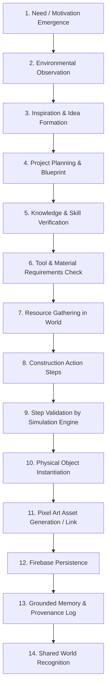

# Mindisle Causality Engine

The foundational architecture component that guarantees every meaningful change in the world has a logical, traceable cause.

## The Causality Chain

No object may appear in Mindisle magically. Every creation must progress through the 14-step causal chain:

## Failure & Consequence Handling

If a character attempts to create something without fulfilling causal dependencies:
- **Missing Resources** (e.g., Naufal wants a chair but has 0 wood):
  - *Result*: Construction is rejected. Naufal experiences frustration, updates his goal to "Find wood", or abandons the project.
- **Missing Knowledge** (e.g., Naufal has stone and wood but doesn't know how to construct a stone well):
  - *Result*: Action fails. He must experiment, read an in-world book, or observe Lauren.
- **Failed Construction Step** (e.g., stamina exhausted or tool breaks mid-craft):
  - *Result*: Project remains partially constructed or ruins into scrap. A grounded episodic memory of the failure is recorded.

## Architectural Rules

1. **Veto Over LLM Output**: Even if Gemini hallucinates *"I have successfully created a chair"*, the Causality Engine checks active inventory and project state; if unfulfilled, the claim is rejected.
2. **Determinism over Complex Calls**: Resource checks, distance to workbenches, inventory counts, and tool degradation use fast, deterministic simulation rules.
3. **Traceable Provenance**: Every created object receives a `provenanceId` linking to its builder, materials, duration, and inspiration.

## Dependencies

- Coordinates with: `creative-engine`, `world-provenance`, `knowledge-and-learning`, `simulation-systems`, `firebase-world-database`.

