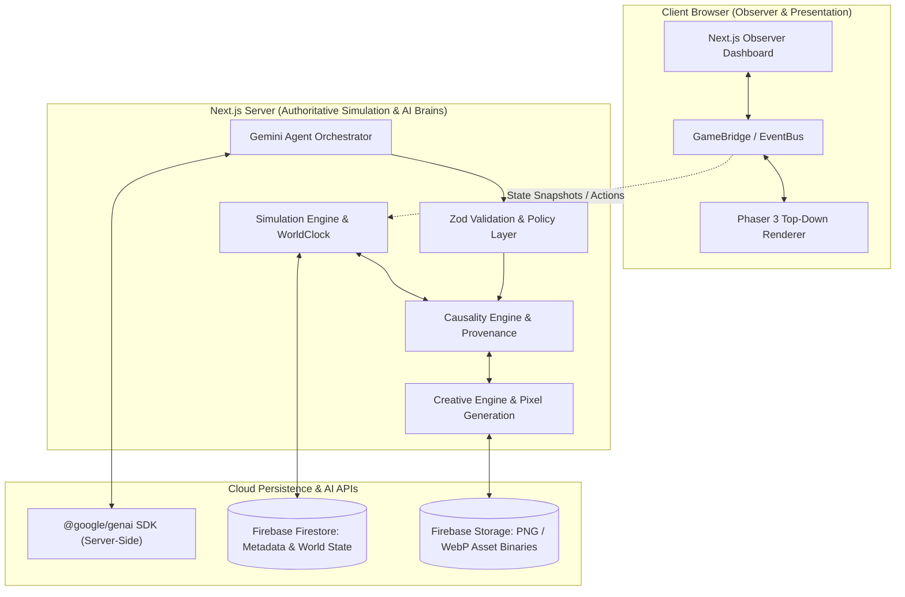
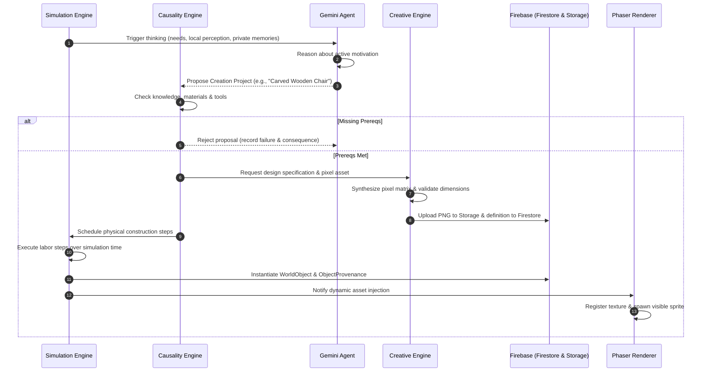

# Mindisle — Technical Architecture

## 1. System Overview

Mindisle separates rendering presentation, deterministic world simulation, AI reasoning, and persistent cloud storage into strictly bounded subsystems.



---

## 2. Core Architectural Invariants

1. **Simulation Engine is Authoritative**:
   - The simulation engine (`src/simulation/`) owns world clock, character positions, collision, inventory, and valid actions.
   - Phaser and Gemini are subordinate to the simulation engine.
2. **Unlimited Imagination, Logical Execution**:
   - The **Creative Engine** allows AI characters to imagine open-ended designs without catalog restrictions.
   - The **Causality Engine** strictly validates that resources, tools, and labor steps exist before any physical world mutation occurs.
3. **Pixel Art Is Actual Data**:
   - Assets are not just prompt descriptions; they are stored as pixel matrices, palettes, and PNG files in Firebase Storage and Firestore.
4. **Asynchronous Non-Blocking Execution**:
   - The Phaser 60 FPS rendering loop never waits synchronously for Gemini or cloud network requests.
   - Decisions are scheduled asynchronously; characters maintain activities or take safe fallbacks if latency occurs.
5. **Epistemic & Memory Privacy**:
   - Naufal and Lauren have isolated contexts. Gemini calls receive only that character's private state, permitted local perceptions, and owned memories.

---

## 3. Module Layout

```text
src/
  app/                      # Next.js App Router (page.tsx, layout.tsx, globals.css)
  components/
    observer/               # React observer dashboard (TopHUD, Minimap, CharacterInspection, EventLog)
  game/
    config.ts               # Phaser game configuration (orthogonal, nearest-neighbor)
    GameBridge.ts           # Decoupled event & action bridge between UI and Phaser
    scenes/
      WorldScene.ts         # Phaser scene: map layers, character sprites, particles, lighting
    assets/
      pixelArtGenerator.ts  # In-engine pixel art rendering & dynamic texture registration
  simulation/
    clock/WorldClock.ts     # Authoritative simulation time, speed multipliers, pause
    navigation/GridMap.ts   # 30x20 orthogonal tile grid
    navigation/CollisionSystem.ts # Walkability, map boundaries & occupant collision
    entities/Character.ts   # Character simulation entity & tile coordinates
    world/WorldState.ts     # Singleton authoritative world state coordinator
    causality/              # Causality Engine: requirements validator, dependency checks
  creative/
    specification/          # Zod ObjectSpecification parser & validator
    generator/              # Procedural pixel matrix synthesis & palette remapping
    validator/              # Visual quality, transparency & dimension validation
  ai/
    gemini/client.ts        # Server-side @google/genai client
    prompts/                # Naufal and Lauren prompt templates
    schemas/                # Zod decision & proposal schemas
    orchestrator.ts         # Agent scheduling & decision lifecycle
  memory/
    retrieval/              # Relevance, recency & importance scoring
    consolidation/          # Memory reflection & summarization
    knowledge/              # Character epistemic graphs (facts, beliefs, suspicions)
  provenance/               # Object creation lineage & audit logs
  firebase/
    admin.ts                # Server-side Firebase Admin SDK
    client.ts               # Client-side Firebase App & Auth
    repositories/           # Firestore collection wrappers
    storage.ts              # Firebase Storage asset uploader & URL resolver
  types/                    # Shared domain types (character, world, events, creative, causality)
```

---

## 4. Decision & Creation Lifecycle



---

## 5. Persistence Stack: Firebase Firestore & Storage

Replaces the legacy Neon PostgreSQL / Prisma stack.
- **Firestore**: World configuration, character state, subcollection memories, object instances, provenance, and event logs.
- **Firebase Storage**: Binary PNG/WebP files, sprite sheets, and asset media.
- Administrative writes are executed server-side via the Firebase Admin SDK.
