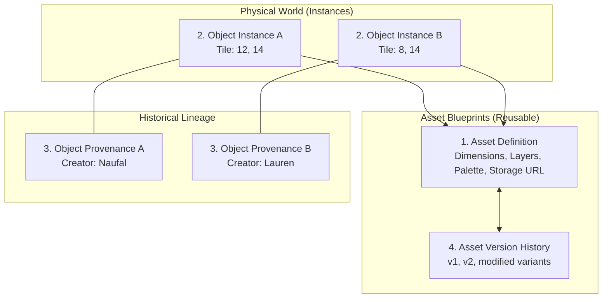

# Mindisle — Pixel Art & Asset System Specification

## 1. Pixel Art Is Actual Data

In Mindisle, visual assets are not ephemeral prompt descriptions or unmanaged image URLs. **Visual assets are structured, versioned, persistent data.**

The system maintains exact pixel-by-pixel awareness of every object, furniture piece, tool, and building created by characters.

---

## 2. Four Core Asset Entities

To prevent redundancy and support scalable worlds, Mindisle separates asset data into 4 distinct layers:



### Entity 1: Asset Definition (`assetDefinitions/{assetId}`)
The master blueprint describing what the object looks like, how big it is, and its interaction semantics.
*Example*: "Carved Oak Chair Definition" (32×32 px, wooden palette, sitting behavior).

### Entity 2: World Object Instance (`objects/{objectId}`)
A physical item placed at tile `(x, y)` in the living world.
*Example*: Chair #1 at `(12, 14)` and Chair #2 at `(8, 14)` both reference the same `assetDefinitionId`.

### Entity 3: Object Provenance (`provenance/{provenanceId}`)
The individual story and material history of each specific instance. Chair #1 was built by Naufal from the north tree; Chair #2 was crafted by Lauren from riverbank driftwood.

### Entity 4: Asset Version History (`assetDefinitions/{assetId}/versions/{v}`)
Tracks evolutionary modifications (e.g. if Lauren paints Naufal's chair blue or carves a flower into the backrest, generating version 2).

---

## 3. Data Representations

### Compact Pixel Matrix (Firestore)
For server-side validation and storage efficiency, pixel grids are represented using Run-Length Encoded (RLE) index arrays:
```json
{
  "width": 32,
  "height": 32,
  "palette": ["#00000000", "#451a03", "#78350f", "#92400e", "#b45309", "#facc15"],
  "rleData": "0x120,1x4,2x6,1x4,0x18,..."
}
```

### Binary PNG (Firebase Storage)
The encoded PNG is stored in Firebase Storage and served over CDN directly to Phaser's texture loader.

---

## 4. Multi-Layer Composition

Complex objects are assembled from semantic layers:
1. **Drop Shadow Layer** (Z: 0): Soft ground contact shadow (`rgba(15, 23, 42, 0.4)`).
2. **Base Structure Layer** (Z: 1): Frame, legs, or foundations.
3. **Detail Layer** (Z: 2): Grain texture, carvings, nails, fabrics.
4. **Highlight Layer** (Z: 3): Warm top-left glints and rim lighting.
5. **Interactive Layer** (Z: 4): Fire animation for campfires, candle flame for lanterns.

