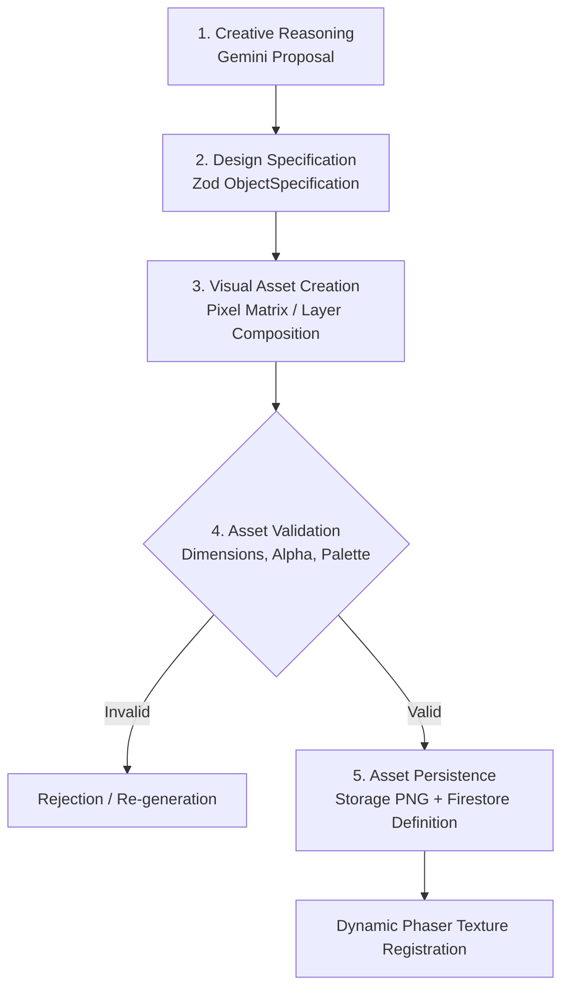

# Mindisle — Creative Engine Specification

## 1. Vision & Core Philosophy

The **Mindisle Creative Engine** empowers autonomous AI characters to imagine, invent, design, and assemble novel items without being constrained to a fixed, hardcoded crafting menu.

Characters can conceive:
- Novel furniture (benches, chairs, tables, storage chests, sleeping mats).
- Hand tools (axes, mallets, fishing poles, chisels).
- Structures & Shelters (lean-tos, canvas tents, stone firepits, fences, sheds).
- Decorations & Art (carved wooden figurines, woven flower wreaths, signposts).
- Machines & Contraptions (water wheels, sundials, bellows).

However, **every creative proposal must be translated into an executable specification that the deterministic simulation engine understands and validates.**

---

## 2. Creative Engine Pipeline



---

## 3. Subsystem Breakdown

### Subsystem A: Creative Reasoning
Gemini interprets the character's active motivation, emotional state, and observed surroundings to invent an object.
*Example*: Naufal is tired and sitting by the lake $\rightarrow$ he imagines a *"Rustic Driftwood Stool with Carved Armrests"*.

### Subsystem B: Design Specification
The raw concept is transformed into a strictly validated `ObjectSpecification`:
```typescript
interface ObjectSpecification {
  id: string; // e.g. "spec_driftwood_stool_v1"
  name: string;
  category: 'furniture' | 'tool' | 'structure' | 'decoration' | 'machine';
  dimensions: {
    tileWidth: number; // e.g. 1
    tileHeight: number; // e.g. 1
    pixelWidth: number; // e.g. 32
    pixelHeight: number; // e.g. 32
  };
  requiredMaterials: Array<{
    materialId: string; // e.g. "wood_driftwood"
    count: number; // e.g. 3
  }>;
  requiredTools: string[]; // e.g. ["stone_mallet"]
  constructionStepsCount: number; // e.g. 4 discrete labor steps
  collisionBox: {
    offsetX: number;
    offsetY: number;
    width: number;
    height: number;
  };
  interactionBehavior: 'sit' | 'rest' | 'store' | 'cook' | 'inspect';
  visualDescription: string;
}
```

### Subsystem C: Visual Asset Creation
Translates specifications into actual visual pixel data:
1. **Procedural Pixel-Matrix Generation**: Generates 2D array of palette indices or RGBA values using structured algorithmic primitives (planks, legs, cushioning, drop shadow).
2. **Layer Composition**: Stacks modular layers (Shadow layer $\rightarrow$ Base Frame $\rightarrow$ Surface Grain $\rightarrow$ Detail Highlights).
3. **Model Generation Integration**: When image-generation models are utilized, their raw outputs are converted into quantized pixel palettes and bounded dimensions.

### Subsystem D: Asset Validation
Before any asset is approved, automated quality gates verify:
- **Dimension Check**: Width and height must be exact multiples of 32px (32×32, 64×32, 64×64).
- **Alpha Mask Check**: Background must be 100% transparent (`alpha = 0`); no opaque white box borders.
- **Palette Conformance**: Pixel colors must map within Mindisle's warm organic color palette; maximum 24 distinct colors per object to preserve retro aesthetic.
- **Perspective Check**: Verified orthogonal top-down view; no side-scroller perspectives.

### Subsystem E: Asset Persistence & Texture Registration
- Upload verified PNG binary to Firebase Storage: `worlds/{worldId}/assets/objects/{assetId}/v1.png`.
- Write metadata to Firestore: `worlds/{worldId}/assetDefinitions/{assetId}`.
- In-memory notification to Phaser: `scene.textures.addCanvas` or `scene.load.image` dynamically registers the new texture without reloading the browser.

