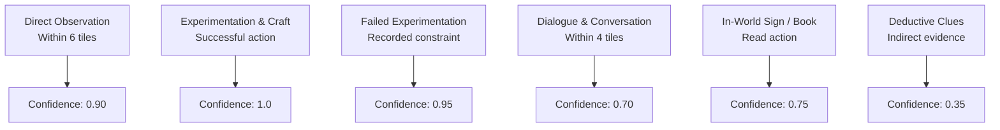

# Mindisle — Epistemic & Knowledge System Specification

## 1. Principles of Character Epistemology

In Mindisle, characters do not possess universal or magical knowledge. Knowledge is an acquired, evolving property of each character's private mental state.

### Core Rules
1. **Zero Telepathy**: Naufal cannot inspect Lauren's thoughts, knowledge graph, or memories, and vice versa.
2. **Grounded Source Attribution**: Every piece of knowledge must record where, when, and how it was acquired.
3. **Confidence Spectrum**: Characters distinguish between certainty, belief, suspicion, and complete ignorance.

---

## 2. Epistemic Confidence Categories

```text
[Confidence 1.0] ────── Known Fact (Direct personal experience or proven physical craft)
       │
[Confidence 0.7] ────── Belief (Learned from a trusted companion or clear demonstration)
       │
[Confidence 0.35] ───── Suspicion / Hypothesis (Inferred from indirect environmental clues)
       │
[Confidence 0.0] ────── Unknown / Unexperienced (Completely absent from mental model)
```

### 1. Known Fact ($0.9 \le \text{confidence} \le 1.0$)
- Acquired through direct physical action or repeated successful execution.
- *Example*: Naufal cut an oak branch and knows oak yields sturdy hardwood planks.

### 2. Belief ($0.5 \le \text{confidence} < 0.9$)
- Acquired from conversation with another character, reading an in-world tome, or observing another character craft from a distance.
- *Example*: Lauren told Naufal that wild lavender grows near the eastern vista. Naufal believes it, but has not yet visited the spot.

### 3. Suspicion / Hypothesis ($0.2 \le \text{confidence} < 0.5$)
- Formed by inductive reasoning from incomplete observations.
- *Example*: Lauren notices wood shavings near the bridge and suspects Naufal is building something there.

### 4. Unknown ($0.0 \le \text{confidence} < 0.2$)
- Concepts the character has never encountered. The character cannot formulate plans requiring this knowledge.

---

## 3. Knowledge Acquisition Channels



### Knowledge Transfer Protocol between Characters
When Naufal explains a crafting technique to Lauren:
1. Naufal executes `SPEAK` with dialogue explaining the technique.
2. The simulation engine asserts Lauren is within hearing distance (4 tiles).
3. Lauren's perception pipeline parses the dialogue.
4. A new document is added to Lauren's `knowledge` subcollection with:
   - `acquisitionSource`: `'conversation'`
   - `sourceCharacterId`: `'naufal'`
   - `confidence`: `0.70`
5. If Lauren later builds the item successfully herself, her confidence upgrades to `1.0` (`'direct_experience'`).

