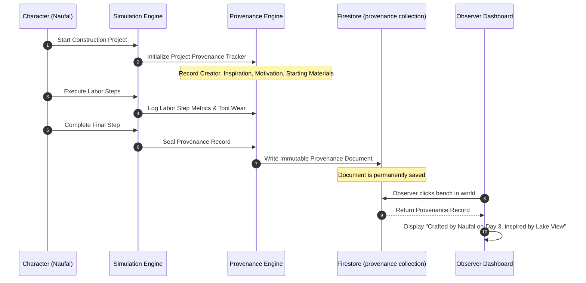

# Mindisle — World Provenance Specification

## 1. Core Principle

In Mindisle, every created object, modified tile, and architectural structure possesses a complete, permanent, and traceable pedigree known as **World Provenance**.

Objects do not exist in a vacuum. If a traveler discovers a wooden bench near the lake 100 days after simulation start, the world retains the full history of how and why that bench came to be.

---

## 2. Complete Provenance Record Contract

Each physical object instantiated in `worlds/{worldId}/objects/{objectId}` references an immutable `ObjectProvenance` record in Firestore:

```typescript
export interface ObjectProvenance {
  id: string; // Unique UUID
  objectId: string; // Target world object ID
  worldId: string;
  
  // 1. Identity & Contributors
  primaryCreatorId: 'naufal' | 'lauren';
  collaborators: string[]; // Other characters who contributed labor steps
  
  // 2. Cognitive Origin (Motivation & Inspiration)
  motivation: string;
  // e.g., "Severe energy fatigue created a physical necessity for elevated seating"
  inspirationSource: string;
  // e.g., "Observed the fallen oak log at tile (4, 4) and the pleasant view of the eastern pond"
  initialIdeaTimestamp: number;
  
  // 3. Material & Resource Traceability
  materialsConsumed: Array<{
    materialId: string; // e.g., "oak_hardwood"
    quantity: number; // e.g., 4
    sourceLocation: { x: number; y: number; landmark?: string };
    harvestedBy: string;
  }>;
  
  // 4. Tools & Crafting Methods
  toolsUsed: string[]; // e.g., ["stone_adze", "wooden_mallet"]
  craftingTechnique: string; // e.g., "notched_timber_joinery"
  
  // 5. Execution Metrics
  constructionStartedAt: number;
  constructionCompletedAt: number;
  totalLaborTicks: number;
  interruptedCount: number;
  failedStepAttempts: number;
  
  // 6. Design & Visual Asset Lineage
  assetDefinitionId: string;
  assetVersion: number;
  visualAssetHash: string;
  
  // 7. Modification History (Appended on repair / alteration)
  modificationLog: Array<{
    modifiedBy: string;
    modificationType: 'repair' | 'recolor' | 'carving' | 'reinforcement';
    timestamp: number;
    notes: string;
  }>;
}
```

---

## 3. Provenance Lifecycle



---

## 4. Observer Mode Integration

When an observer clicks any created object on the game canvas:
1. The canvas emits an `INSPECT_OBJECT` event with `objectId`.
2. The right-hand sidebar switches to **Provenance Inspection View**, displaying:
   - Creator avatar and name tag.
   - Original inspiration and motivation.
   - Material sources (with mini-map pin indicating where the wood was cut).
   - Labor time and tools utilized.
   - Historical modification log.

